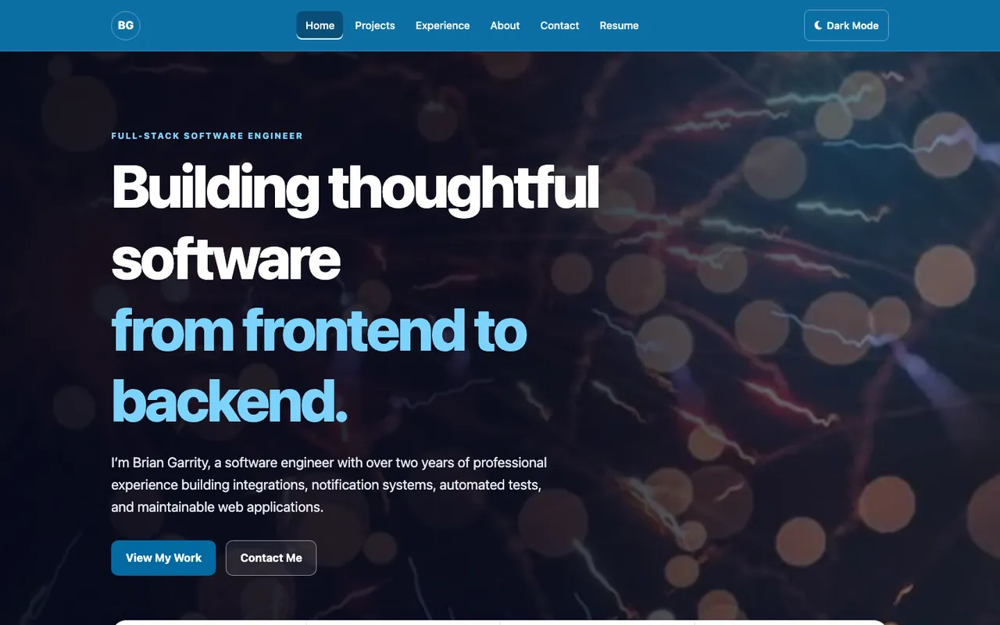
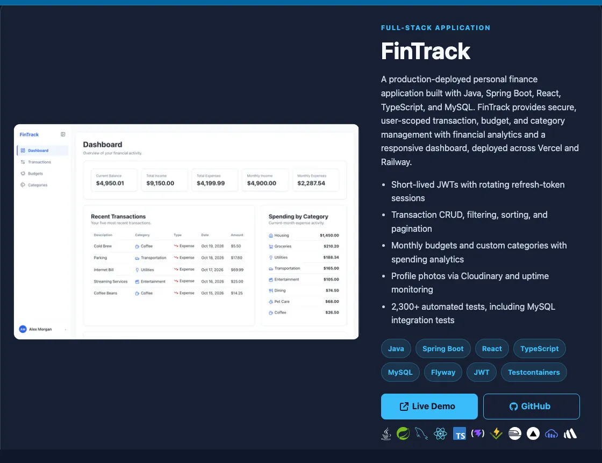
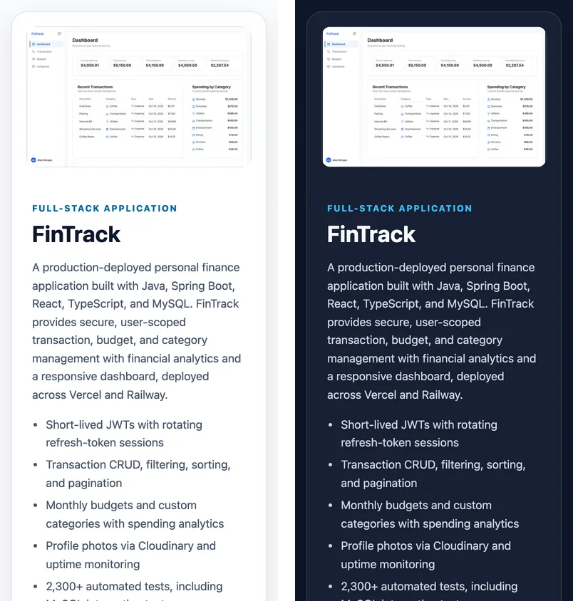

# Brian Garrity Portfolio


A responsive, accessible portfolio showcasing my professional experience, featured software projects, skills, and contact information. Built with plain HTML, CSS, and JavaScript, with no framework and no third-party scripts.

**Live site:** https://garrib10.github.io/portfolio-website/

---

## Screenshots

### Home



### Featured project (dark mode)



### Mobile (light and dark)



---

## Features

- **Responsive layout** from 320px phones to wide desktops, with a mobile navigation that keeps every section visible
- **Light and dark themes** that follow the system setting, remember the visitor's choice, and apply before the first paint (no flash)
- **Accessible** markup: skip link, visible focus states, labelled controls, screen-reader context on project links, and WCAG AA color contrast in both themes
- **Fast** loading: responsive WebP screenshots, lazy-loaded images, a 10 KB SVG icon sprite, and no external CSS, fonts, or scripts
- **Contact form** that submits in the background through Formspree and shows the result inline, with a spam honeypot and a plain-HTML fallback
- **Resume download** and links to GitHub and LinkedIn
- **Link previews** with a dedicated 1200×630 social card for LinkedIn, Slack, and X

### Quality checks (live site, October 2026)

| Check | Result |
|---|---|
| Lighthouse, mobile and desktop | 100 Performance · 100 Accessibility · 100 Best Practices · 100 SEO |
| axe-core (WCAG 2.2 AA + best practices), light and dark, desktop and mobile | 0 violations |
| W3C HTML validator | 0 errors |

---

## Featured Projects

### [FinTrack](https://github.com/garrib10/finance-operations-dashboard) · [Live demo](https://finance-operations-dashboard.vercel.app/)

A production-deployed personal finance application built with Java, Spring Boot, React, TypeScript, and MySQL.

- Short-lived JWTs with rotating refresh-token sessions and user-scoped data
- Transactions with filtering, sorting, and pagination; monthly budgets and custom categories with spending analytics
- Profile photos via Cloudinary and uptime monitoring
- 2,300+ automated backend and frontend tests, including MySQL integration tests with Testcontainers
- Deployed on Vercel (frontend) and Railway (API and MySQL)

### [FinTrack Selenium Automation Suite](https://github.com/garrib10/fintrack-selenium-automation) · [v1.1.0](https://github.com/garrib10/fintrack-selenium-automation/releases/tag/v1.1.0)

A standalone end-to-end regression suite for the deployed FinTrack application, built with Java, Selenium WebDriver, JUnit 5, and Maven.

- 16 browser test classes covering authentication, transactions, budgets, categories, and the dashboard
- Page Object Model with explicit-wait synchronization and run-specific test data with cleanup
- Headed and headless Chrome, plus browser-free unit tests for the framework
- GitHub Actions, CodeQL, and automatic failure evidence

### [TaskFlow](https://github.com/garrib10/taskflow) · [Live demo](https://taskflow-garrib10.vercel.app/)

A frontend-only Kanban board built with React, TypeScript, and Vite.

- Four-stage workflow with capacity limits and parent-completion guards
- Drag-and-drop and keyboard task movement; independent Priority and Manual ordering
- Combined search and filters; linked subtasks with progress
- Versioned browser-storage persistence with migration and recovery
- Automated Vitest and Playwright regression tests

### [Job Search Manager API](https://github.com/garrib10/job-search-manager-api) · [Explore the API](https://job-search-manager-api-production.up.railway.app/docs)

A production-deployed REST API built with FastAPI, SQLAlchemy, and MySQL for tracking a job search.

- JWT authentication, Argon2 password hashing, and per-user data isolation
- Companies, applications, interviews, and follow-up tasks, plus a job-search summary endpoint
- Search, filtering, sorting, and pagination; Alembic migrations
- 328 automated tests with 99% coverage, run against MySQL in CI before deploying to Railway

---

## Tech Stack

| Area | Tools |
|---|---|
| Markup and styling | HTML5, CSS3 (custom properties for theming, no CSS framework) |
| Behavior | Vanilla JavaScript (theme, active navigation, contact form) |
| Icons and logos | SVG sprite of [Font Awesome Free](https://fontawesome.com/) 6.4.0 icons; [Devicon](https://devicon.dev/) 2.17.0 and official brand logos, all served locally |
| Services | [Formspree](https://formspree.io/) (contact form), GitHub Pages (hosting) |

---

## Project Structure

```text
portfolio-website/
├── assets/
│   ├── icons/          # favicon and icons.svg (SVG icon sprite)
│   ├── images/         # project screenshots (WebP), hero background, social card
│   ├── logos/          # technology logos
│   ├── screenshots/    # images used in this README
│   └── profile.webp
├── resume/
│   └── Brian-Garrity-Resume.pdf
├── index.html
├── styles.css
├── scripts.js
├── LICENSE
└── README.md
```

---

## Running Locally

```bash
git clone https://github.com/garrib10/portfolio-website.git
cd portfolio-website
python3 -m http.server 8000
```

Then open http://localhost:8000. Any static server works (for example, VS Code Live Server). Opening `index.html` directly from the file system won't show the icons, because browsers block the SVG sprite on `file://` pages.

---

## Deployment and Workflow

The site deploys to GitHub Pages from the `main` branch.

Changes follow a `feature/fix branch → pull request → develop → local staging verification → release pull request → main` workflow.

GitHub Pages lets browsers cache files for 10 minutes, so `index.html` loads `styles.css` and `scripts.js` with a version query string (for example `styles.css?v=2026-10-23`). When a change touches either file, update the date in both links so visitors get the new page and its matching stylesheet and script together. Branch rulesets prevent deleting `develop` and `main` or force-pushing to them, and `main` only accepts changes through pull requests.

---

## Security and Privacy

- No third-party scripts, stylesheets, or fonts are loaded; all assets are served from this repository.
- External links open with `rel="noopener noreferrer"`.
- The contact form posts to Formspree over HTTPS and includes a honeypot field to filter spam.
- GitHub Pages serves the site over HTTPS with HSTS, but doesn't allow custom response headers such as Content-Security-Policy. A host like Netlify or Vercel would be needed to set those.

---

## Future Enhancements

- GitHub Actions checks on pull requests (HTML validation, internal link check, and an accessibility scan)
- Higher-resolution hero and profile images

---

## Credits

- Icons: [Font Awesome Free](https://fontawesome.com/license/free) by Fonticons, Inc., licensed under CC BY 4.0
- Technology logos: [Devicon](https://github.com/devicons/devicon) (MIT) and the respective projects' brand assets

---

## License

[MIT](LICENSE)
